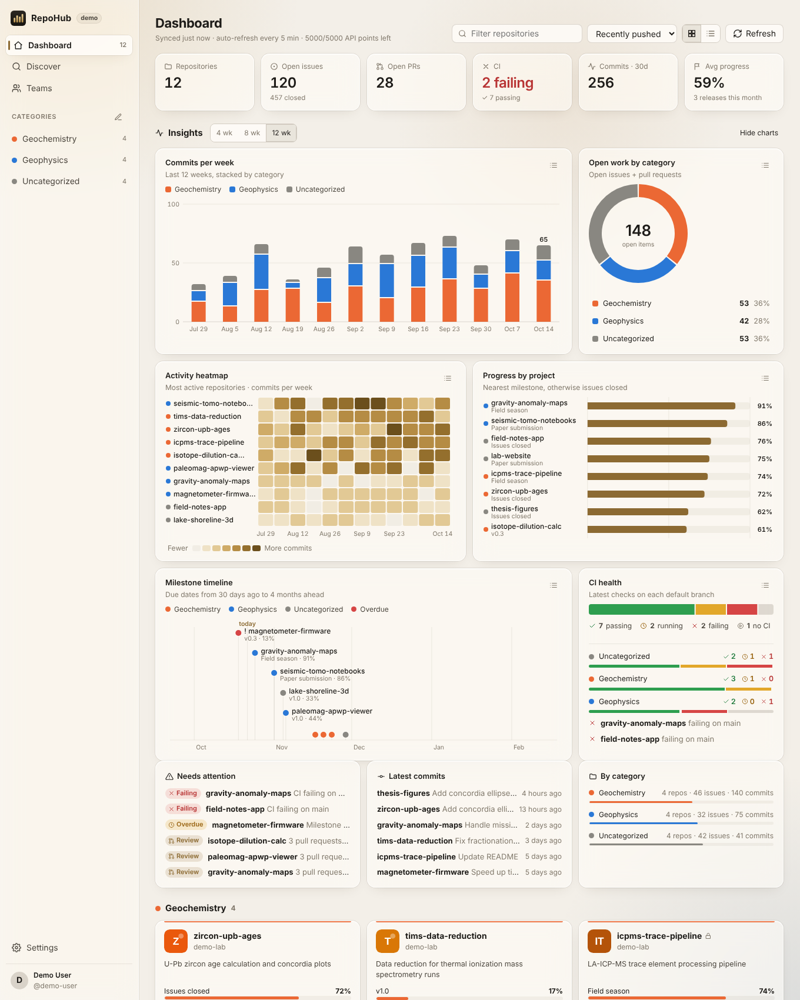
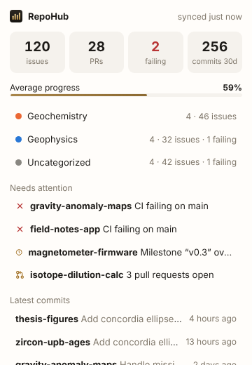
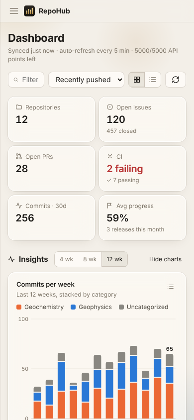
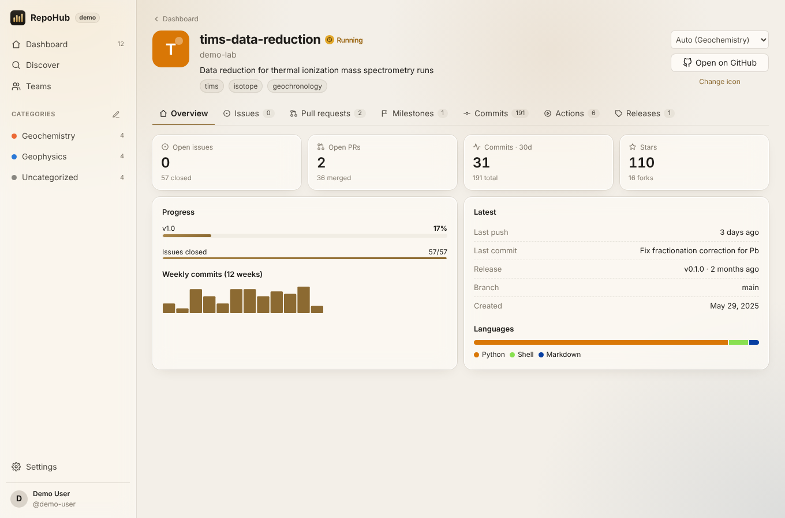
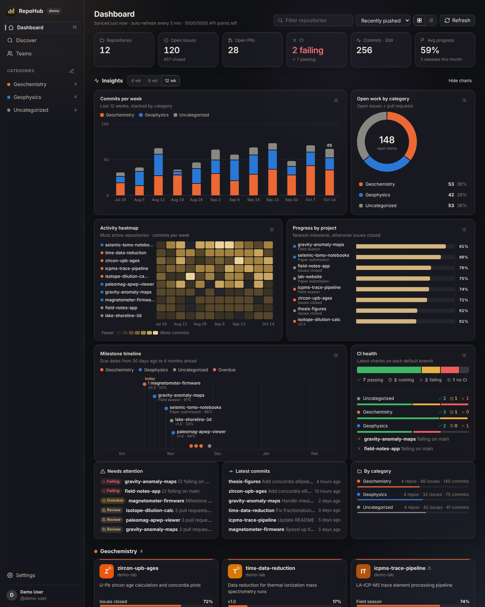

# RepoHub

A lightweight, fast dashboard, with a quiet "Ivory & Brass" glass theme (and a "Midnight & Brass" dark mode), for keeping track of GitHub projects. It runs on **macOS, Windows and iOS** from one codebase (Tauri 2 + React) and lives in the **menu bar / system tray** with live stats.



| Menu-bar popover | iPhone layout | Repo detail |
| --- | --- | --- |
|  |  |  |



## Features

- **GitHub login.** Uses the OAuth device flow, so no client secret ships with the app. You can paste a personal access token instead. The token is kept in the OS keychain (macOS/iOS Keychain, Windows Credential Manager).
- **Progress that updates itself.** Polls GitHub every 1–60 minutes (configurable), when the window regains focus, and when you pick "Refresh now" from the tray. For each repo it shows:
  - milestone progress (nearest open milestone) and the share of issues closed
  - open and merged PRs, review state and checks on each PR
  - CI status from the default branch's status checks, plus recent GitHub Actions runs
  - an 8-week commit sparkline, the latest commit and the latest release
  - stars, forks and languages
- **Insights charts.** Each one answers a different question, and clicking any mark opens the repo or category behind it:
  - commits per week, stacked by category (4, 8 or 12 weeks)
  - an activity heatmap of the most active repos
  - progress bars ranking each project
  - a donut of open work by category
  - a milestone timeline with a "today" line and overdue flags
  - CI health, overall and per category
  
  Every chart has a hover tooltip and a table view. Data colors use a colorblind-validated palette.
- **Status you can read at a glance.** Everywhere in the app: ✓ green means passing, ◷ amber means running, ✕ red means failing, and – gray means no CI. Status is never shown by color alone.
- **Clear navigation.** Overview, category and repo views. Each repo has tabs for Issues, Pull requests, Milestones, Commits, Actions and Releases. There's also a "Needs attention" feed (failing CI, overdue milestones, PR backlog).
- **Categories you can edit.** Ships with Geochemistry and Geophysics. You can add, rename, recolor, reorder and delete categories. Repos are sorted automatically by keywords in their name, description and topics, and picking a category on a card always overrides that.
- **Repo icons.** Read from the repo itself: `icon`/`logo`/`favicon` files in the root, `.github`, `assets`, `docs`, `images` or `public` folders. If none is found it falls back to the repo's custom social preview, then to a colored monogram. Icons are cached for 7 days, private repos work, and you can set a custom URL per repo.
- **Discover.** Search GitHub for ready-to-use projects, with topic presets for each category and filters for "maintained in the last year", open-source license, minimum stars and language. Click **Track** to add a repo to your dashboard with live progress.
- **Menu bar / tray.** On macOS the menu bar shows live stats next to the icon, for example `⊙ 42  ⑂ 7  ✕ 1`, and you choose which stats appear. Left-click opens a popover summary, right-click opens a menu with the numbers plus Open, Refresh and Quit. Closing the window keeps RepoHub running in the tray.
- **In-app updates, CodexBar style.** RepoHub checks for new releases in the background (shortly after launch, then every 6 hours) and downloads them quietly. When an update is ready you get an inline **Update ready — restart now?** action in the sidebar, the tray menu and the menu-bar popover. One click installs it and relaunches. You can also check by hand from Settings → Updates, turn automatic downloads off, or switch to the **Beta** channel to get pre-releases.
- **Teams (groundwork).** Local teams with member roles and category scopes, plus a read-only view of your GitHub organizations and their teams. See the [roadmap](#roadmap).
- **Demo mode** lets you explore the UI without signing in (`?demo` in the browser, or "Explore with demo data").

## Quick start

Prerequisites: [Node 20+](https://nodejs.org), [Rust](https://rustup.rs), and the [Tauri prerequisites](https://v2.tauri.app/start/prerequisites/) for your OS (Xcode for macOS/iOS, WebView2 + MSVC build tools on Windows).

```bash
npm install
npm run app:dev        # desktop app with hot reload
npm run dev            # UI only, in the browser (http://localhost:1420/?demo)
npm run app:build      # installers in src-tauri/target/release/bundle
```

### 1. Create a GitHub OAuth App (one time)

1. GitHub → **Settings → Developer settings → OAuth Apps → New OAuth App**.
2. Homepage URL: `https://github.com/duserzym/repohub`. Callback URL: the same URL (the device flow doesn't use it).
3. After creating it, tick **Enable Device Flow** and copy the **Client ID**. Do not generate a client secret.
4. Either put it in `.env` as `VITE_GITHUB_CLIENT_ID=...` (see `.env.example`) or paste it on the login screen.
   For CI builds, set it as the repository variable `GITHUB_OAUTH_CLIENT_ID`.

Requested scopes: `repo` (so private repos are included), `read:org`, `read:user`.

### 2. iOS

On a Mac with Xcode:

```bash
npm run ios:init       # generates src-tauri/gen/apple (commit it)
npm run ios:dev        # run in the simulator or on a connected device
npm run ios:build      # archive for TestFlight / App Store (needs a signing team)
```

The UI switches to a phone layout with a slide-in sidebar and safe-area insets. iOS has no tray, so the menu-bar code is compiled only for desktop (`#[cfg(desktop)]`).

### Releases & in-app updates

1. **One-time setup (on your Mac):** run `npm run updater:setup`. It creates a signing key at `~/.tauri/repohub-updater.key`, writes the public key into `src-tauri/tauri.conf.json` (commit that change), and stores the private key as the GitHub secret `TAURI_SIGNING_PRIVATE_KEY` using `gh`. If `gh` isn't signed in, add the secret by hand. Keep the private key safe, because installed apps only accept updates signed with it.
2. Bump `version` in `package.json` and `src-tauri/tauri.conf.json`, then push a tag like `v0.2.0`. Tags containing `-beta` (for example `v0.3.0-beta.1`) become pre-releases, which only the Beta channel sees.
3. CI builds a universal macOS `.dmg` and a Windows installer, signs the update bundles, and attaches them plus `latest.json` to a **draft** release. Publish the draft and installed copies of RepoHub pick it up on their next check.

Every push to `main` also uploads installers as workflow artifacts. Local `npm run app:build` doesn't need the key, because updater artifacts are only enabled by `tauri.release.conf.json` in CI.

> Note: updates are signature-checked by Tauri. For a smooth macOS experience, sign and notarize with an Apple Developer ID (set `APPLE_CERTIFICATE`, `APPLE_SIGNING_IDENTITY`, `APPLE_ID`, `APPLE_PASSWORD` and `APPLE_TEAM_ID` secrets for tauri-action). Unsigned builds still work, but Gatekeeper will warn on first launch.

## How it works

```
src/                    React UI (Vite, TypeScript, no UI framework)
  lib/github.ts         GraphQL + REST client, all queries in one place
  lib/queries.ts        TanStack Query hooks (polling, caching, tray sync)
  lib/summary.ts        stats, "needs attention", menu-bar title
  lib/categories.ts     default categories + keyword auto-classification
  lib/icons.ts          repo icon discovery and caching
  lib/state.tsx         settings, categories, assignments, tracked repos, teams
  lib/updater.ts        update scheduler + inline update state
  components/charts.tsx SVG charts (stacked columns, heatmap, bars, donut, timeline, status meter)
  views/                Dashboard, RepoDetail, Discover, Teams, Settings, TrayPopover
src-tauri/
  src/lib.rs            keychain commands, tray summary state, window behavior
  src/tray.rs           menu-bar / tray item, menu and popover window
  src/updater.rs        background update check / download / install + relaunch
scripts/validate-graphql.mjs   checks every query against GitHub's public schema
```

- **Fast.** One GraphQL request per 25 repos loads everything the dashboard needs. A full refresh of 100 repos costs a few API points out of the 5,000/hour budget, and the remaining budget is shown in the header. The JS bundle is about 85 kB gzipped and desktop installers are typically 10–15 MB.
- **Progress %.** The nearest open milestone's completion if the repo has one, otherwise closed ÷ total issues.
- **Local data.** Settings, categories, assignments and the icon cache live in the app's data folder (`repohub.json`, `icons.json`). The token is stored in the keychain only.

## Roadmap

- [ ] Team management: sync local teams with GitHub org teams, share category layouts across a team, per-member activity
- [ ] Shared team dashboards (hosted sync)
- [ ] Notifications when CI breaks or a milestone becomes overdue
- [ ] Android build (Tauri supports it, but it's untested here)
- [ ] Optional menu-bar-only mode on macOS (no Dock icon)

## License

MIT
